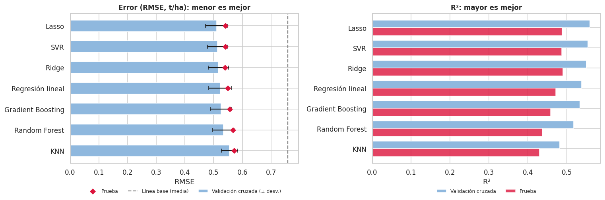

# 🌾 Predicción del rendimiento agrícola

Proyecto final de Machine Learning. La pregunta era sencilla: ¿se puede estimar cuántas toneladas por hectárea (`yield_ton_ha`) va a dar una parcela a partir de su suelo y su clima?

Este repositorio tiene el notebook con todo el análisis, el modelo ya entrenado y una app de Streamlit para hacer predicciones.

## Qué hace la app

- **Una parcela:** mueves los valores de N, P, K, temperatura, humedad, pH, lluvia y tipo de suelo, y te da el rendimiento estimado con un rango probable (intervalo del 95 %). Si no conoces algún dato, lo desmarcas y el modelo lo rellena con la mediana de entrenamiento. También muestra cómo cambia el resultado al mover una sola variable.
- **Varias parcelas:** subes un CSV y te devuelve el mismo archivo con la predicción y el intervalo de cada fila, listo para descargar. Trae una plantilla de ejemplo.
- **Sobre el modelo:** métricas en prueba, las variables que más pesan y la comparación de los siete modelos.

## Resultados

Se compararon siete modelos de regresión (regresión lineal, Ridge, Lasso, KNN, SVR, Random Forest y Gradient Boosting) con validación cruzada de 5 pliegues. Ganó **Lasso** (`alpha = 0.01`).

| R² | RMSE | MAE | MAPE | Frente a predecir siempre la media |
|---|---|---|---|---|
| 0,488 | 0,541 t/ha | 0,433 t/ha | 12,5 % | 28,6 % menos error |

Lo más importante que salió del análisis:

- Casi toda la capacidad de predicción está en el **nitrógeno, el fósforo y el potasio**. Un modelo con solo esas tres variables rinde igual que el completo.
- Los modelos lineales igualaron o superaron a los más complejos.
- Los valores imposibles (N negativo o de 500, pH de 0,5 o 14, lluvia de −10 o 2000) se corrigieron sin borrar filas. La lluvia se recuperó a partir de la columna en pulgadas.
- El modelo explica más o menos la mitad de la variación. Sirve para orientar y comparar escenarios, no para dar una cifra exacta por parcela, y por eso la app siempre muestra el rango.

<p align="center">
  
</p>

## Estructura

```
├── app.py                  # App de Streamlit
├── utils.py                # Carga del modelo, limpieza de entradas y predicción
├── requirements.txt        # Dependencias (scikit-learn fijado en 1.6.1)
├── requirements-dev.txt    # Lo anterior + pytest
├── .streamlit/config.toml  # Colores de la app
├── models/
│   ├── modelo_rendimiento.joblib   # Pipeline completo: imputación + escalado + one-hot + Lasso
│   └── metadata.json               # Rangos, métricas, intervalo, importancias
├── notebooks/              # Análisis completo y entrenamiento
├── reports/figures/        # Gráficos del análisis
└── tests/                  # Pruebas del modelo y de la app
```

## Correrla en tu computador

```bash
python -m venv .venv
source .venv/bin/activate        # En Windows: .venv\Scripts\activate
pip install -r requirements-dev.txt
pytest -q
streamlit run app.py
```

## Publicarla en Streamlit Community Cloud

1. Entra a <https://share.streamlit.io> con tu cuenta de GitHub.
2. Clic en **Create app** → **Deploy a public app from GitHub**.
3. Repositorio: `despliegue-proyecto-final-agricola`, rama `main`, archivo principal `app.py`.
4. En **Advanced settings** elige Python **3.12** (o 3.13).
5. **Deploy**. Cada vez que hagas `git push` a `main`, la app se actualiza sola.

> El modelo se guardó con scikit-learn 1.6.1 y por eso `requirements.txt` fija esa versión. Si la cambias, el `.joblib` puede cargar mal.

## Sobre los datos

El archivo original `Crop_Agriculture.csv` trae nombres completos y teléfonos, así que no se sube al repositorio (está en el `.gitignore`). La app no lo necesita: todo lo que usa está en `models/`.

## Limitaciones

- Es un dataset didáctico de 1.200 registros (240 en prueba) con ruido metido a propósito en varias columnas. Lo que se encontró describe este conjunto y no se debería trasladar tal cual a la agricultura real.
- El 96 % de los registros es de Colombia.
- Faltan variables que seguramente explican el resto de la variación: cultivo o variedad, manejo, fecha de siembra, riego y fertilización.
